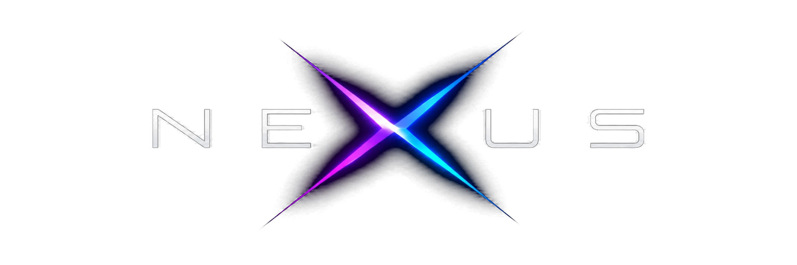

<h3 align="center">Nexus Game Launcher</h3>

<b>Your PC, played like a console.</b> 
A full-fledged couch gaming launcher for Windows.

---

## What is Nexus?
Why can't PC gamers enjoy cozy couch gaming sessions, just like consoles do?

Nexus turns your Windows PC into a console. Grab your controller, sit back on
the couch, and launch any PC game from one beautiful, fullscreen home screen,
without ever touching a mouse or keyboard.

## Features
- **Console-style home screen.** Full-screen game art, smooth animations and a
  cinematic intro, made for the big screen.
- **All your games in one place.** Automatically finds games from Steam,
  Epic Games, GOG Galaxy, Ubisoft Connect, Battle.net and Xbox / Game Pass,
  plus your own game folders.
- **Open it from anywhere.** Hold View + Start on your controller, even in the
  middle of a game. The game pauses while Nexus is open.
- **Quick settings from the couch.** Wi-Fi, Bluetooth, sound, microphone,
  brightness, night light and Do not disturb.
- **Beautiful artwork.** Covers, backgrounds and logos for every game,
  from SteamGridDB.
- **Playtime tracking.** Time played and last played for every game.
- **Controller tools.** Button and stick test, vibration test, and haptic
  feedback while browsing.
- **Every input works.** Controller first, with full keyboard and mouse
  support.
- **YouTube on the big screen.** Launch YouTube's TV experience, driven by
  your controller.
- **Guided setup**, collections, favorites, search, backup and restore, and
  Start with Windows.

## Install
1. Download the latest **Nexus_x.x.x_x64-setup.exe** from
   [Releases](../../releases/latest).
2. Run it. If Windows shows "Windows protected your PC", choose
   **More info → Run anyway**.
3. Follow the welcome screens. A controller is recommended.

Nexus keeps itself up to date: new versions are offered right inside the app.

**Requirements:** Windows 10 or 11 (64-bit) · Xbox-compatible controller
recommended · free SteamGridDB API key optional (for artwork)

## Credits
Artwork by SteamGridDB and its community artists. Game names, logos and
artwork belong to their respective owners. Nexus is not affiliated with
YouTube, Microsoft, Valve or any game publisher.

## Creator
Crafted by **RASAMANEY**, Motion designer - Video editor - Tech enthusiast
[Portfolio](https://rasafolio.vercel.app) ·
[LinkedIn](https://www.linkedin.com/in/rajamanistark/) ·
[Instagram (work)](https://www.instagram.com/rasagrid/) ·
[Instagram](https://www.instagram.com/rasamaney/)

© 2026 RASAMANEY. All rights reserved.
